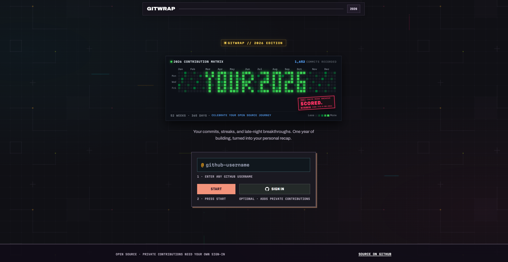
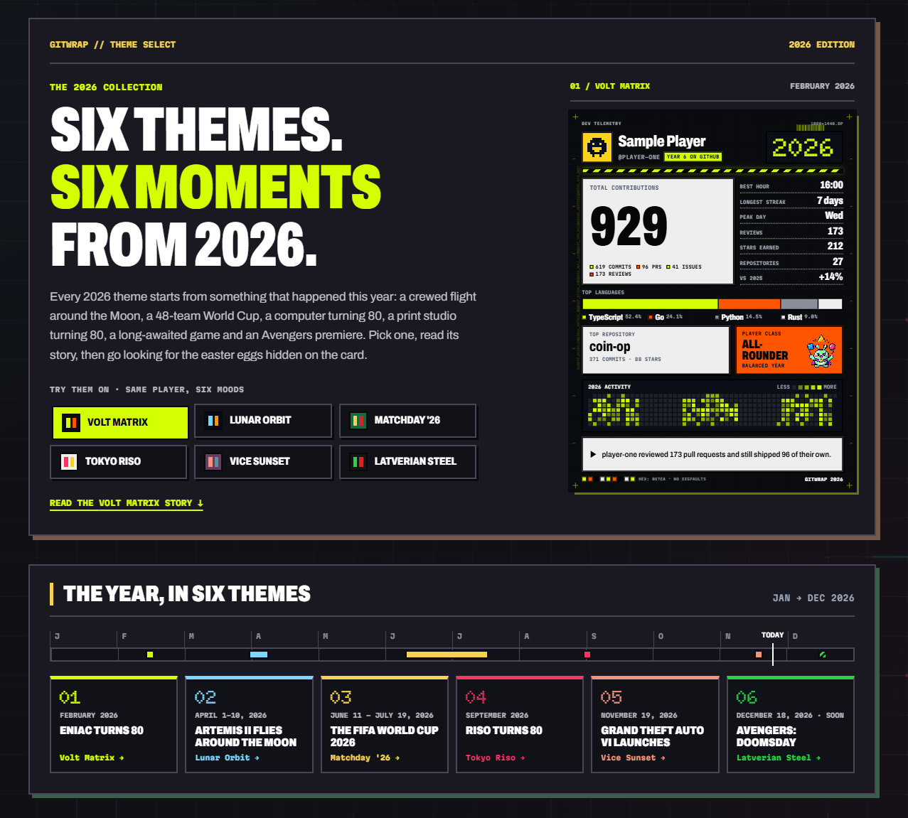
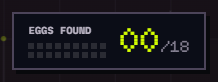

<div align="center">
  

  <p style="margin-top:16px;font-size:18px;font-weight:600;">Showcase your GitHub contributions with an arcade-crafted year-in-review card and an interactive story recap.</p>

  <p>
    <a href="https://www.gitwrap.tech/"><strong>Live App (gitwrap.tech)</strong></a> &nbsp;&bull;&nbsp;
    <a href="https://www.gitwrap.tech/themes"><strong>Theme Guide</strong></a> &nbsp;&bull;&nbsp;
    <a href="https://github.com/aftab-s/gitwrap"><strong>GitHub Repository</strong></a>
  </p>
</div>

# GitWrap

GitWrap generates high-fidelity, arcade-inspired year-in-review cards and interactive recaps for GitHub developers.
Live at **[https://www.gitwrap.tech/](https://www.gitwrap.tech/)**.

When GitWrap debuted for the 2025 season, it gave developers an arcade-style card summarizing their public activity. But two clear requests emerged from community feedback:
1. Most developers write their most critical code inside private repositories for employers or clients. A recap that only counted public commits left out their biggest accomplishments.
2. Developers wanted an engaging, interactive recap they could tap through, similar to Spotify Wrapped, before exporting the final image card.

GitWrap 2026 is the direct sequel built to answer both.

---

## What Is New in the Sequel

- **Private Contributions (Sign in with GitHub):** Optional GitHub OAuth flow with read-only access. It accurately aggregates your private commits, pull requests, code reviews, and issues into your overall score. Private repository names are masked on public views so proprietary project names remain confidential.
- **10-Slide Tap-Through Story Mode:** A complete interactive recap (Spotify Wrapped format) that breaks down your year slide by slide before you export your card:
  1. Opening Credits / Player ID Pass with avatar and telemetry summary.
  2. Attendance Speedo Gauge and Consistency Rating.
  3. 52-Week Mini Heatmap Mosaic with quarterly activity pods (Q1 to Q4) and elastic pop physics.
  4. 24-Hour Combat Radar Clock visualizing peak productive coding windows.
  5. Streak Multipliers and Segmented Momentum Capacitor Bar.
  6. Pull Request Velocity and shipping cadence.
  7. Issue Tracker and Code Review contributions.
  8. Polyglot Language Matrix with balanced stack dominance analysis.
  9. Community and Collaboration impact.
  10. Player Archetype reveal, 16-bit virtual pet companion badge, and 3D arcade card print feed.
- **Interactive 7x52 Hero Contribution Graph:** An animated, responsive GitHub calendar matrix on the landing page that spells "YOUR 2026" across 52 weeks and 7 rows. Features Story 3 elastic pop entrance physics (`mosaicPop`), organic background activity noise, interactive cell tooltips with commit stats, and a dual-mode stamped certification seal (`SCORED.`) toggleable between Tokyo Riso Hanko and Volt Matrix themes.
- **Subtle CPU Circuit Pulse Background:** Ambient semiconductor-style optical data signals streaming across micro-trace buses with 90-degree interconnects, rendered with 0.8px hairline paths, optical bloom, and pre-warmed negative animation delays for continuous motion from frame zero.
- **Six Bespoke 2026 Themes:**
  - **Matchday '26 (`fifa`)** — Procedural fluid flow fields, kinetic streamlines, polished metallic gold "2026", and dynamic stadium tricolor inspired by World Cup 2026.
  - **Lunar Orbit (`artemis`)** — Translunar trajectory vectors, celestial coordinate rings, and lunar slate cartography inspired by NASA Artemis II.
  - **Vice Sunset (`gtavi`)** — Humid neon dusk gradient, crepuscular sunburst rays, high-contrast scoreboard telemetry, and photographic grain inspired by GTA VI.
  - **Latverian Steel (`doomsday`)** — Mystic alchemy summoning circles, runic columns, imperial Latverian emerald, and gunmetal armor inspired by Avengers Doomsday.
  - **Volt Matrix (`maxdark`)** — Cybernetic circuit traces, neon yellow terminals, authentic vector barcode stamps, and hex debug memory stream ticker.
  - **Tokyo Riso (`maxlight`)** — Japanese ISBN barcodes, red Hanko inspection seals, halftone grain, CMYK color separation density patches, and Swiss printer crop marks.
- **Interactive Theme Guide (`/themes`):** Try all six themes on a live sample card, explore their 2026 timeline, compare the 2025 and 2026 editions, and uncover Easter eggs with on-card spotlights and locally saved discovery progress. Access it from the homepage footer or the studio’s customization header.
- **Player Archetypes & 16-Bit Virtual Pets:** 13 distinct archetypes computed deterministically from your data (Night Owl, Early Riser, Bug Hunter, Weekend Warrior, Streak Keeper, Marathoner, Code Reviewer, PR Shipper, Polyglot, Specialist, Sprinter, All-Rounder, New Challenger) paired with 16-bit virtual pet companion sprites and commit action verb analysis.
- **Production Export Pipeline:** Pixel-perfect 1080x1440 PNG card generation using an isolated offscreen iframe, self-hosted web fonts (`Archivo`, `Martian Mono`, `Doto`), and Base64 pre-inlined image assets to ensure consistent rendering across Safari, iOS, and desktop browsers.

---

## Active Edition & Deployment

The latest version of GitWrap is live at **[https://www.gitwrap.tech/](https://www.gitwrap.tech/)**.

GitWrap 2026 covers contributions logged across **Dec 1, 2025 to Nov 30, 2026**.
- `/` is the landing page and username dispatcher.
- `/u/<username>` is the dedicated player studio, recap player, and export deck.
- `/themes` is the public theme guide, live sample-card gallery, and interactive Easter-egg hunt.
- `/2025` redirects to the archived 2025 edition.

All edition windows, year constants, and repository links are centrally configured in [`config.ts`](config.ts).

---

## Explore the 2026 Themes

The theme guide at `/themes` introduces the artwork, inspirations, and hidden details behind GitWrap 2026. It builds on the original 2025 edition and uses the same card renderer as the studio, with fictional sample data rather than a real developer’s statistics.



### Find the guide

- **Homepage:** Select **Explore 2026 themes** in the footer, beside **Star on GitHub**.
- **Player studio:** Select **Theme guide ↗** in the **Customize Your Card** header.
- **Direct URL:** Open `/themes`; generating a recap or signing in is not required.

### What you can explore

- **Live theme try-on:** Switch the hero card between all six colourways. The selector supports arrow-key navigation, and each selection links to its theme’s story.
- **2026 timeline:** Browse the events and anniversaries chronologically, with date ranges, upcoming-event labels, and a current-date marker during 2026.
- **2025 → 2026 comparison:** See the original mood-based palettes alongside the new edition’s event-inspired artwork and hidden details.
- **Six detailed exhibits:** Each pairs a sample card and palette swatches with the inspiration, key facts, visual treatment, and source links.

- **Interactive Easter-egg hunt:** Select a numbered card marker or a clue to highlight its location and reveal its meaning. A floating counter tracks discoveries, celebrates completion, and offers a reset. Progress is saved in this browser’s local storage when available; the hunt also works without storage.



The guide distinguishes real references from decorative card text, including fictional telemetry and publishing labels. Volt Matrix and Tokyo Riso began as design studies; their 2026 connections are the ENIAC and RISO anniversaries. Source links and the fact-check date are recorded with the guide content. These themes are independent visual tributes, not official collaborations.

### Maintaining the guide

- [`themeGuide.ts`](themeGuide.ts): Theme stories, timeline dates, source links, Easter-egg clues, and the legacy 2025 palette list. The total discovery count is derived from the entries.
- [`pages/ThemesPage.tsx`](pages/ThemesPage.tsx) and [`pages/ThemesPage.css`](pages/ThemesPage.css): Page layout, theme switcher, timeline, card spotlights, and discovery controls.
- [`constants.ts`](constants.ts): Shared theme colours and export dimensions.
- [`demo.ts`](demo.ts): Deterministic fictional sample statistics used throughout the guide.
- [`THEMES.md`](THEMES.md): Detailed design inspirations, palette notes, and Easter-egg references.

Each clue’s `spot` corresponds to a `data-egg` attribute in [`ArcadeCard.tsx`](components/ArcadeCard.tsx) or [`ThemeBackdrop.tsx`](components/ThemeBackdrop.tsx). Keep those identifiers aligned when changing the card artwork so the spotlight continues to locate the correct detail.

---

## Architecture & Security

The browser client never holds any elevated GitHub credentials or AI API keys. Serverless functions in [`api/`](api) handle all upstream communication with the GitHub GraphQL API, Gemini, and Groq:

| Endpoint | Method | Purpose | Caching Strategy |
|---|---|---|---|
| `/api/stats?username=&year=` | `GET` | Public wrap data fetched using server's shared token. | CDN edge cached for 1 hour (`s-maxage=3600`). |
| `/api/stats?username=&year=&private=1` | `GET` | Private wrap data fetched using the authenticated owner's token. | Strictly private (`no-store`), rejected unless session matches. |
| `/api/auth/login` | `GET` | Initiates the GitHub OAuth authorization code flow. | No cache. |
| `/api/auth/callback` | `GET` | Validates CSRF `state`, exchanges code for token, sets encrypted cookie. | No cache, redirects to `/u/<login>`. |
| `/api/auth/me` | `GET` | Returns authenticated user's login and OAuth availability. | Session-checked. |
| `/api/auth/logout` | `POST` | Clears the session cookie and signs the user out. | No cache. |

### Security Guarantees:
- **Zero Client-Side Secrets:** No environment variables use the `VITE_` prefix for secrets, preventing sensitive tokens from being bundled into client JavaScript.
- **AES-256-GCM Session Encryption:** The user's OAuth access token is stored strictly inside an AES-256-GCM sealed, `HttpOnly`, `Secure`, `SameSite=Lax` cookie with an 8-hour TTL.
- **Minimal Scopes:** Requests `read:user` and `repo` (required by GitHub OAuth to read commit contribution counts in private repositories). The server issues read-only GraphQL queries and never performs write operations.
- **Private View Isolation:** The private contribution view is only visible to the signed-in repository owner. Shared links or third-party visitors always receive the sanitized public view.

---

## Quick Start (Development)

### 1. Clone the repository
```bash
git clone https://github.com/aftab-s/gitwrap.git
cd gitwrap
```

### 2. Install dependencies
```bash
npm install
```

### 3. Configure environment variables
Copy the example environment configuration to `.env.local`:
```bash
# On Linux / macOS:
cp .env.example .env.local

# On Windows (PowerShell):
copy .env.example .env.local
```
Fill in at least `GITHUB_APP_TOKEN` (a classic GitHub Personal Access Token with **no scopes**).

### 4. Run the local development server
```bash
npm run dev
```
Open [http://localhost:3000](http://localhost:3000) in your browser.

> **Note:** The Vite dev server includes a built-in API proxy plugin (see [`vite.config.ts`](vite.config.ts)) that executes the `/api` serverless endpoints locally without requiring the Vercel CLI.

---

## Environment Variables Reference

Configure these in `.env.local` for local development and under **Vercel -> Project Settings -> Environment Variables** for production deployments:

| Variable | Required | Description |
|---|---|---|
| `GITHUB_APP_TOKEN` | **Yes** | Shared GitHub Personal Access Token (classic PAT, **0 scopes needed**) for public lookups (5,000 req/hr). |
| `GITHUB_CLIENT_ID` | Optional | GitHub OAuth App Client ID (enables user sign-in & private contribution counting). |
| `GITHUB_CLIENT_SECRET` | Optional | GitHub OAuth App Client Secret. |
| `SESSION_SECRET` | Optional | Random 32+ character string used to encrypt session cookies via AES-256-GCM. |
| `GEMINI_API_KEY` | Optional | Google Gemini API key for personalized AI one-liner summaries. |
| `GEMINI_MODEL` | Optional | Model identifier (defaults to `gemini-2.5-flash-lite`). |
| `GROQ_API_KEY` | Optional | Groq API key (used as alternative or fallback AI provider). |
| `GROQ_MODEL` | Optional | Model identifier for Groq (defaults to `qwen/qwen3.8-27b`). |
| `APP_URL` | Optional | Public origin override for OAuth callback redirect (auto-detected by default). |
| `VITE_GITHUB_REPOSITORY`| Optional | Target repository for community contributors widget (defaults to `aftab-s/gitwrap`). |

Generate a secure `SESSION_SECRET` with:
```bash
node -e "console.log(require('crypto').randomBytes(32).toString('base64url'))"
```

---

## GitHub OAuth Setup Guide (Sign-In)

To enable private repository contributions:
1. Navigate to **GitHub -> Settings -> Developer settings -> OAuth Apps -> [New OAuth App](https://github.com/settings/applications/new)**.
2. Fill in the details:
   - **Application name:** `GitWrap`
   - **Homepage URL:** `http://localhost:3000` (or your live domain)
   - **Authorization callback URL:** `http://localhost:3000/api/auth/callback` (or `https://your-domain.com/api/auth/callback`)
3. Click **Register application**.
4. Copy the **Client ID**, generate a **Client Secret**, and paste them into your `.env.local` alongside a generated `SESSION_SECRET`.

---

## Project Structure

```
gitwrap/
├── api/                             # Vercel Serverless Functions
│   ├── _lib/                        # Server-only utilities (GitHub GQL, session crypto, AI)
│   │   ├── commitAnalysis.ts        # Commit message verb parsing & local hour detection
│   │   ├── funMessage.ts            # Gemini & Groq one-liner generation
│   │   ├── github.ts                # GitHub GraphQL queries & stat normalization
│   │   └── session.ts               # AES-256-GCM cookie sealing & OAuth helpers
│   ├── auth/                        # Authentication endpoints (/login, /callback, /me, /logout)
│   └── stats.ts                     # Main wrap aggregation API endpoint
├── components/                      # React UI Components
│   ├── icons/                       # Arcade icons, GitHub, X, and LinkedIn vectors
│   │   ├── Arcade.tsx               # Pixel/arcade icon set (arrows, controls, badges)
│   │   ├── LinkedInIcon.tsx         # LinkedIn sharing vector
│   │   └── XIcon.tsx                # X / Twitter sharing vector
│   ├── ArcadeCard.tsx               # Master 1080x1440 arcade card canvas
│   ├── Contributors.tsx             # GitHub open-source contributors grid
│   ├── ExportCard.tsx               # Offscreen print wrapper with inlined assets
│   ├── Footer.tsx                   # Shared footer; optional theme-guide link beside GitHub
│   ├── FuturisticLoader.tsx         # Cybernetic HUD radar & telemetry loader
│   ├── GitHubSignIn.tsx             # OAuth sign-in / sign-out button
│   ├── GitWrapCard.tsx              # Responsive auto-scaling preview container
│   ├── HeroContributionGraph.tsx    # Animated 7x52 contribution board & Scored seal
│   ├── HomeFusionBackdrop.tsx       # Ambient CPU circuit pulse backdrop
│   ├── Marquee.tsx                  # Floating navigation bar with hazard stripes
│   ├── PlayerAvatar.tsx             # 16-bit virtual pet companion renderer
│   ├── SocialShare.tsx              # One-click native & social sharing controls
│   ├── Stories.tsx                  # 10-slide tap-through interactive recap carousel
│   ├── ThemeBackdrop.tsx            # Bespoke thematic backdrops for cards
│   └── ThemeSelector.tsx            # Six-colourway swatch picker
├── pages/
│   ├── HomePage.tsx                 # Landing page with hero dispatcher & fusion backdrop
│   ├── UserPage.tsx                 # Studio command deck, card preview & download controls
│   ├── ThemesPage.tsx               # Theme try-on, timeline, comparison & Easter-egg hunt
│   └── ThemesPage.css               # Responsive arcade-panel styles for the theme guide
├── public/                          # Static assets (fonts, virtual pet avatars, theme graphics)
│   ├── avatars/                     # 16-bit player companion sprites
│   ├── fonts/                       # Local variable fonts (Archivo, Martian Mono, Doto)
│   └── images/                      # Open Graph, banners, and preview art
├── config.ts                        # Edition definitions, date ranges & repository metadata
├── constants.ts                     # Colourway themes, design tokens & export metrics
├── insights.ts                      # Player class archetype scoring logic & metrics
├── playerAvatars.ts                 # 16-bit virtual pet companion mappings
├── themeGuide.ts                    # Theme stories, sources, timeline dates & egg locations
├── THEMES.md                        # Theme design notes, palettes & reference details
├── types.ts                         # TypeScript types & Zod schemas
└── vite.config.ts                   # Vite configuration with local API proxy
```

---

## Contributing

Contributions are welcome. Whether reporting a bug, improving responsive styles, or adding features:
1. Fork the repository.
2. Create your feature branch (`git checkout -b feature/amazing-feature`).
3. Commit your changes (`git commit -m 'feat: add amazing feature'`).
4. Push to the branch (`git push origin feature/amazing-feature`).
5. Open a Pull Request.

---

---

<div align="center">
  <p>Crafted for developers around the world 💜</p>
</div>
