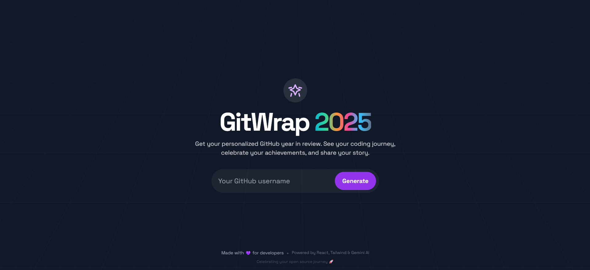

<div align="center">
  

  <p style="margin-top:12px;font-size:18px;">Showcase your 2026 GitHub contributions with a polished, customizable year-in-review card - themeable, concise, and ready to share.</p>
</div>

# GitWrap 2026

> Create a polished year-in-review card for your GitHub contributions and share it with your network.

## ✨ Highlights

- **Personalized Stats:** Commits, PRs, Issues, and Reviews aggregated into one card.
- **🔒 Private contributions (new):** Sign in with GitHub to include work from private repositories. Private repo names are hidden on the card unless you opt in.
- **🕹️ Recap stories (new):** before the card, a tap-through recap of the year: score, calendar, best hour, streak, languages, top repositories.
- **Player class and signature move (new):** an archetype earned from your own numbers (Night Owl, Streak Keeper, Code Reviewer, ...) and the verb that opens most of your commit messages.
- **Six colourways** and a **shareable 1080×1440 PNG export**. What you see on screen is the exact image you download.
- **AI (Text Only):** Gemini writes the one-liner on the card (falls back to a template).

## 📅 The 2026 edition

This app is GitWrap 2026 only (Dec 1 2025 → Nov 30 2026). `/` is the landing page and `/u/<name>` is a user's wrap. The original 2025 design (and its own data) lives separately in the `gitwrap-2025` project — it is not part of this codebase and this project never routes to it.

The wrap window and repo URL live in [`config.ts`](config.ts)'s single `EDITION` constant.

## 🕹️ Design

The 2026 UI is drawn as the printed control panel of an arcade machine: one flat colour field per colourway, black keylines, square keys that press down, and no rounded corners or blur anywhere. The rules live in [`DESIGN.md`](DESIGN.md); colourways are defined in [`constants.ts`](constants.ts), and the card itself is [`components/ArcadeCard.tsx`](components/ArcadeCard.tsx).

## 🔐 Architecture & security

The browser never holds an API token. A handful of Vercel serverless functions in [`api/`](api) do all the talking to GitHub and Gemini:

| Endpoint | What it does |
|---|---|
| `GET /api/stats?username=&year=` | Public wrap, fetched with the server's `GITHUB_APP_TOKEN`. CDN-cached for an hour. |
| `GET /api/stats?username=&year=&private=1` | The signed-in owner's wrap incl. private repos, fetched with *their* token. Never cached. Rejected unless the session belongs to that username. |
| `GET /api/auth/login` → `GET /api/auth/callback` | Standard GitHub OAuth web flow with a `state` check. The code → token exchange uses the client secret server-side. |
| `GET /api/auth/me`, `POST /api/auth/logout` | Who is signed in (login only) / sign out. |

- **No secrets in the bundle.** No environment variable is `VITE_`-prefixed, so nothing is compiled into client JavaScript.
- **The user's GitHub token is never exposed to the page.** It is stored only in an AES-256-GCM-encrypted, `HttpOnly`, `Secure`, `SameSite=Lax` cookie (8-hour lifetime) that only the `/api` functions can decrypt.
- **Scopes:** `read:user` and `repo`. GitHub OAuth Apps have no read-only scope for private repositories; the server only ever sends read queries.
- The private view is shown **only to the signed-in owner**. A shared link always shows the public view, and private repository names are hidden on the card unless the owner opts in.
- **Organization repos:** if an org restricts third-party OAuth app access, its private repos stay invisible until an org owner approves the app.

## 🚀 Quick Start (Development)

```powershell
git clone https://github.com/aftab-s/gitwrap-2026.git
cd gitwrap-2026
npm install
copy .env.example .env.local   # then fill it in
npm run dev                    # http://localhost:3000  (frontend + /api on one port)
```

`npm run dev` serves the `/api` functions through a small Vite plugin (see [`vite.config.ts`](vite.config.ts)), so the Vercel CLI isn't needed locally.

### Environment variables

Set these in `.env.local` for development and in **Vercel → Project → Settings → Environment Variables** for production.

| Variable | Required | Purpose |
|---|---|---|
| `GITHUB_APP_TOKEN` | Yes | Token for public lookups. A classic PAT with **no scopes** is enough. |
| `GITHUB_CLIENT_ID`, `GITHUB_CLIENT_SECRET` | For sign-in | Your GitHub OAuth App's credentials. |
| `SESSION_SECRET` | For sign-in | Random 32+ character string that encrypts the session cookie. `node -e "console.log(require('crypto').randomBytes(32).toString('base64url'))"` |
| `GEMINI_API_KEY` | No | Gemini one-liner on the card (falls back to a template). `GEMINI_MODEL` overrides the model. |
| `APP_URL` | No | Force the public origin used for the OAuth redirect (auto-detected by default). |

Sign-in UI appears only when all three sign-in variables are set; without them the app works in public-only mode.

### GitHub sign-in setup (2 minutes)

1. GitHub → *Settings* → *Developer settings* → *OAuth Apps* → **New OAuth App**.
2. *Homepage URL*: your site. *Authorization callback URL*: `<your site>/api/auth/callback`.
3. Copy the **Client ID**, generate a **Client secret**, and set them with a `SESSION_SECRET` as above.

An OAuth App allows one callback URL, so create a second app for local development with the callback `http://localhost:3000/api/auth/callback`.

## 🕹️ How the player class works

- The class is computed in `insights.ts` from the stats already on the card: commit hours, weekend share, longest streak, active days, reviews, pull requests and language mix. Each class has a threshold; the one cleared by the widest margin wins, so the same year always gives the same class.
- The signature move comes from the server's commit scan (`api/_lib/commitAnalysis.ts`): the first word of each commit message, matched against a closed list of verbs (Fix, Add, Update, ...). Only those verbs are ever reported, never text from a commit message.

## 🧩 Project Structure

- `config.ts` — the 2026 edition's date range, repo URL (shared by client and server)
- `pages/`, `components/` — React UI: landing page, wrap page, the card (`ArcadeCard`), sign-in key, AI stats panel
- `index.css`, `constants.ts` — the design system: type, keys, windows, and the six colourways
- `services/api.ts`, `services/auth.ts` — browser-side calls to our own `/api`
- `api/stats.ts`, `api/auth/*.ts` — serverless endpoints
- `api/_lib/github.ts` — GraphQL fetch + stat derivation (server-only)
- `api/_lib/commitAnalysis.ts` — commit scan, AI detection, commit hours (server-only)
- `api/_lib/session.ts` — encrypted cookie session + OAuth state (server-only)
- `api/_lib/funMessage.ts` — Gemini one-liner (server-only)

## 🤝 Contributing

Contributions are welcome. Open an issue for discussion or submit a PR with your changes.

## 👥 Contributors

<a href="https://github.com/aftab-s/gitwrap-2026/graphs/contributors">
  
</a>

---

Happy wrapping! 🎁
